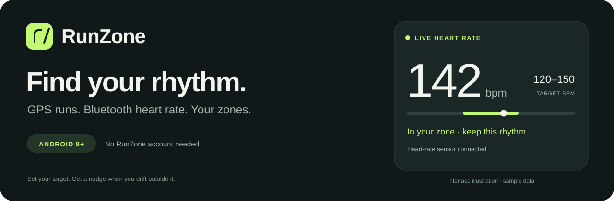

# RunZone



[](https://github.com/K33k0/Run-tracker/actions/workflows/android.yml)
[](https://github.com/K33k0/Run-tracker/actions/workflows/secrets.yml)
[](https://github.com/K33k0/Run-tracker/actions/workflows/release.yml)

**An Android running tracker built around your heart-rate zones.**

Set the effort you want to run at. RunZone tracks your route, reads your Bluetooth heart-rate monitor and gives you sound and vibration warnings when you stay above or below your target.

[**Download the latest APK**](https://github.com/K33k0/Run-tracker/releases/latest) · [All releases](https://github.com/K33k0/Run-tracker/releases) · [Report an issue](https://github.com/K33k0/Run-tracker/issues)

> **Early release:** GPS tracking, live heart rate, zone alerts, run history and TCX exports are available. Direct account syncing is still awaiting provider setup. Further outdoor and screen-off testing is ongoing.

## What it does

| Feature | What you get |
| --- | --- |
| **Heart-rate zone coaching** | Five editable target profiles, with different sound/vibration warnings above and below your active range. |
| **Live BPM before a run** | Connect your Bluetooth sensor and see your heart rate immediately. No running timer needed. |
| **GPS tracking and a live map** | Route recording, distance, duration and average pace, with street maps, zoom and recenter controls. |
| **Optional auto-pause** | Choose a pace threshold. Recording pauses after sustained slower movement and resumes when you speed up. |
| **Run history** | Open a saved run for its route, active/elapsed time, pace, heart-rate stats and chart. New recordings include kilometre splits. |
| **TCX export** | Save or share a workout file for Smashrun, Runalyze, Strava or another compatible service. |

## Install

1. Open the [latest GitHub Release](https://github.com/K33k0/Run-tracker/releases/latest).
2. Download the `RunZone-vX.Y.Z.apk` file to your phone.
3. Open it and allow installation from your browser/file manager if Android asks.

**Requirements:** Android 8.0 or newer. A Bluetooth heart-rate monitor is optional; GPS recording works on its own. Sensors must broadcast the standard Bluetooth LE Heart Rate Service. A smartwatch needs a compatible heart-rate broadcast mode to act as a sensor.

Release APKs use a permanent signing certificate. Each release includes a SHA-256 checksum and the public signing-certificate fingerprint.

<details>
<summary>Already using a development/debug build?</summary>

Development builds and production releases use different signing certificates, so Android cannot install one directly over the other. Export runs you want to keep before removing a development build. **Uninstalling clears its private recordings and settings.** Importing those exported files back into RunZone's History is not currently supported.

The release workflow never uninstalls or changes the app on your phone. See [release and signing details](RELEASING.md).

</details>

## Your first run

1. **Set your target:** open **Settings → Heart-rate zones**, choose a profile and enter your lower/upper BPM limits.
2. **Connect your sensor:** wear/wake your monitor, tap **Sensor** on the Run screen and select it. Live BPM should appear before you start.
3. **Allow location:** use the map's recenter button and grant location permission. Precise location is needed for run recording; Bluetooth connection asks for Nearby devices permission on newer Android versions.
4. **Start running:** tap **Start run**. Pause/resume whenever you need to, then **Finish → Save run**.
5. **Review it:** open **History**, select your run and scroll to **Sync & Export** to save or share a TCX file.

Keep media volume audible for the warning tones. Zone and location controls live in Settings, so the Run screen stays focused on your workout.

### How the zone warnings work

Your lower and upper limits are inclusive. After five continuous seconds outside them, RunZone sounds and vibrates a warning, repeating every twenty seconds while you remain outside the target. Previewing your BPM or pausing a run does not trigger coaching alerts. A sensor reading that is more than ten seconds old is shown as missing.

### Auto-pause

Auto-pause is **off by default**. Enable it in Settings and choose **Pause when slower than**; the default is 12:00 min/km.

RunZone waits ten seconds below the speed threshold before pausing and three seconds clearly above it before resuming. Poor or lost GPS does not count as standing still. A manual pause always needs a manual resume.

## Smashrun, Runalyze and Strava

| Service | TCX file export | Direct account sync |
| --- | --- | --- |
| Smashrun | Available | Provider setup pending |
| Runalyze | Available | Provider setup pending |
| Strava | Available | Provider setup pending |

TCX files preserve recorded timing, distance, GPS and heart rate when available. Missing sensor data is left out. Runs without GPS may not import into Smashrun.

Use the service's file importer: [Smashrun](https://smashrun.com/faq/basics), [Runalyze](https://runalyze.com/activity/new-upload) or [Strava](https://www.strava.com/upload/select).

The account-connection and background-sync code is included, but provider registrations are not complete yet. **Direct sync is not currently available.** Once enabled, users will sign into their own accounts; new saved runs can sync automatically, while older runs upload only when their owner chooses. App owners can find setup instructions in the [account service guide](server/README.md).

## Your data

- **No RunZone account is needed** to record, review or export runs.
- Routes and heart-rate recordings are stored in the app's private storage on your phone. Uninstalling removes them, so export anything you want to keep.
- Street maps come from [OpenStreetMap](https://www.openstreetmap.org/copyright). Uncached map tiles need internet access; GPS recording does not. Map requests share the requested map area and your network connection with the tile provider.
- Account connections are optional. When enabled, recordings upload directly to the selected service. The shared account service handles sign-in and token refresh; it does not receive run recordings.
- Provider tokens are encrypted on the phone with Android Keystore. App secrets and signing keys are excluded from this repository. See [SECURITY.md](SECURITY.md).

## Current limitations

This is an early version. Sensor disconnections need manual reconnection, and an active run is not recovered if Android terminates the process or the app is force-stopped. Older recordings show the data that was saved at the time; their start time is estimated and kilometre splits are unavailable. Outdoor GPS accuracy, automatic pause/resume and screen-off behavior need more real-run validation.

## Build and contribute

Use Android Studio or Java 17 with Android SDK 35:

```sh
./gradlew testDebugUnitTest assembleDebug lintDebug
```

For the account-service and release-tool tests:

```sh
node --test server/broker.test.mjs
python3 -m unittest discover -s scripts -p 'test_*.py'
```

[Development guide](docs/DEVELOPMENT.md) · [Automatic releases](RELEASING.md) · [Account service](server/README.md) · [Provider registration](server/REGISTRATION.md) · [Security](SECURITY.md)

Found a problem? [Open an issue](https://github.com/K33k0/Run-tracker/issues) with your Android version, app version, sensor model if relevant, and steps to reproduce it. Leave out account tokens, private routes and other personal data.
